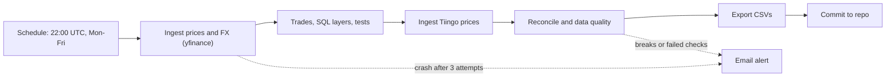

# Automated Financial Data Pipeline

[](https://github.com/ZJA97/fin-data-pipeline/actions/workflows/pipeline.yml)

An automated pipeline that ingests daily market data for 25 securities, validates it, and models it into analysis-ready tables.

See [docs/SCOPE.md](docs/SCOPE.md) for the full scope and phases.

## Security universe

| Group | Tickers |
|---|---|
| UK equities (7) | SHEL.L, AZN.L, HSBA.L, ULVR.L, BP.L, LLOY.L, BARC.L |
| US equities (10) | AAPL, MSFT, NVDA, GOOGL, AMZN, JPM, JNJ, XOM, PG, KO |
| ETFs (7) | SPY, QQQ, VTI, AGG, GLD, VWRL.L, ISF.L |
| Index (1) | ^FTSE (benchmark, not traded) |

All 25 tickers resolved and were validated in Phase 1.

## Status

## Status

- [x] Phase 0: Setup
- [x] Phase 1: Ingestion
- [x] Phase 2: Ledger and valuation
- [x] Phase 3: Reconciliation and data quality
- [x] Phase 4: Automation
- [ ] Phase 5: Dashboard
- [ ] Phase 6: AI summary and polish

## Phase 1: Ingestion

Python scripts that pull prices and FX into raw SQLite tables, with logging and error handling.

- **Config-driven:** every ticker and FX pair lives in [`config/tickers.yaml`](config/tickers.yaml), not in code. Add or remove a line and re-run.
- **Fetch:** `yfinance` pulls daily bars for 25 securities and 4 FX pairs into the tables `raw_prices` and `raw_fx`.
- **Validated at ingestion:** rows with missing, non-numeric or non-positive prices (open, high, low, close, adj_close) are rejected before insert and logged with a count. Everything else is stored as received.
- **Incremental:** each run only loads days newer than what is already stored, and only completed trading days.
- **Resilient:** each symbol is retried with backoff, and one failing ticker is logged without stopping the rest.
- **Logged:** console output plus a rotating log file at `logs/pipeline.log`.

### Data quality checks

These run after ingestion, as a second safeguard over what is stored.

| Check | Fails when |
|---|---|
| `ticker_resolved` | a configured ticker returned no rows |
| `no_duplicates` | a (ticker, date) pair appears more than once |
| `no_long_gaps` | consecutive dates for a ticker are more than `max_gap_days` apart |
| `positive_prices` | any price is zero or negative, or `close` is missing |

The run exits with code `1` if any ingestion step or check fails, so a scheduler can alert on it later.

### Run it (Windows PowerShell)

```powershell
python -m venv .venv
.venv\Scripts\Activate.ps1
pip install -r requirements.txt

python -m pipeline.run     # ingest, then run the checks
python -m pytest           # 2 tests: the checks, and ingestion validation
```

### Example output

Output of a re-run after the fix below. Ticker lines are abridged.

```text
13:48:52 INFO    === Ingestion ===
13:48:53 INFO    AAPL: no new rows since 2026-10-23
13:48:53 INFO    MSFT: no new rows since 2026-10-23
13:48:53 INFO    GOOGL: no new rows since 2026-10-23
13:48:53 INFO    AMZN: no new rows since 2026-10-23
13:48:53 INFO    NVDA: no new rows since 2026-10-23
13:48:53 INFO    JPM: no new rows since 2026-10-23
13:48:53 INFO    XOM: no new rows since 2026-10-23
13:48:54 INFO    JNJ: no new rows since 2026-10-23
13:48:54 INFO    PG: no new rows since 2026-10-23
13:48:54 INFO    KO: no new rows since 2026-10-23
13:48:54 INFO    HSBA.L: no new rows since 2026-10-23
13:48:54 INFO    BP.L: no new rows since 2026-10-23
13:48:54 INFO    SHEL.L: no new rows since 2026-10-23
13:48:54 INFO    AZN.L: no new rows since 2026-10-23
13:48:54 INFO    ULVR.L: no new rows since 2026-10-23
13:48:54 INFO    LLOY.L: no new rows since 2026-10-23
13:48:55 INFO    BARC.L: no new rows since 2026-10-23
13:48:55 INFO    SPY: no new rows since 2026-10-23
13:48:55 INFO    QQQ: no new rows since 2026-10-23
13:48:55 INFO    VTI: no new rows since 2026-10-23
13:48:55 INFO    VWRL.L: no new rows since 2026-10-22
13:48:55 INFO    ISF.L: no new rows since 2026-10-23
13:48:55 INFO    AGG: no new rows since 2026-10-23
13:48:55 INFO    GLD: no new rows since 2026-10-23
13:48:55 INFO    ^FTSE: no new rows since 2026-10-23
13:48:55 INFO    raw_prices: 25 symbols, 0 new rows, 0 failed
13:48:55 INFO    GBPUSD=X: no new rows since 2026-10-23
13:48:55 INFO    EURUSD=X: no new rows since 2026-10-23
13:48:55 INFO    EURGBP=X: no new rows since 2026-10-23
13:48:56 INFO    USDJPY=X: no new rows since 2026-10-23
13:48:56 INFO    raw_fx: 4 symbols, 0 new rows, 0 failed
13:48:56 INFO    === Data quality checks ===
13:48:56 INFO    raw_prices PASS ticker_resolved  25/25 tickers have data
13:48:56 INFO    raw_prices PASS no_duplicates    no duplicate ticker/date rows
13:48:56 INFO    raw_prices PASS no_long_gaps     no gaps longer than 7 days
13:48:56 INFO    raw_prices PASS positive_prices  all prices positive
13:48:56 INFO    raw_fx PASS ticker_resolved  4/4 tickers have data
13:48:56 INFO    raw_fx PASS no_duplicates    no duplicate ticker/date rows
13:48:56 INFO    raw_fx PASS no_long_gaps     no gaps longer than 7 days
13:48:56 INFO    raw_fx PASS positive_prices  all prices positive
13:48:56 INFO    Finished: all good
```

### Data quality incident and fix

On the first full run, ingestion reported no failures, but the `positive_prices` check failed. One `VWRL.L` row dated 2026-10-23 had open, high, low and volume, but no `close` or `adj_close`. Querying Yahoo Finance directly for that date returned no price data, so the missing values were left unfilled rather than estimated.

**Cause:** ingestion inserted whatever came back without validating prices. Because loads start after the latest stored date, a bad row that was already stored would never be refetched.

**Fix:**
- `pipeline/ingest.py` now rejects rows with missing, non-numeric or non-positive prices before insert, and logs how many were rejected per symbol.
- `tests/test_ingest.py` is a regression test using simulated data and in-memory SQLite (no network). It checks that a bad row is rejected and a good row is stored.
- The single bad row was deleted after confirming that exactly one row matched, so the next run can try to fetch that date again.
- After the fix, all 8 checks (4 per table) passed.

**Known limitation:** the checks confirm that stored data is valid, not that it is up to date. At the time of writing, `VWRL.L` ended at 2026-10-22 because Yahoo had not returned a valid bar for the 23rd. A freshness check would catch this and is not yet implemented.

### Project layout

```text
config/tickers.yaml         instruments and settings
pipeline/config.py          config loader
pipeline/logging_setup.py   logging setup
pipeline/db.py              SQLite schema and helpers
pipeline/ingest.py          fetch, retry, validate, load
pipeline/checks.py          data quality checks
pipeline/run.py             entry point
tests/test_checks.py        test for the checks
tests/test_ingest.py        regression test for ingestion validation
```


## Phase 2: Ledger and valuation 

Turns raw market data plus a synthetic trade ledger into daily positions, market value and P&L in GBP.

### Data flow

| Layer | Tables | Purpose |
|---|---|---|
| Raw | `raw_prices`, `raw_fx`, `raw_trades` | Data exactly as loaded, defects included |
| Cleaned | `clean_prices`, `clean_fx`, `clean_trades`, `dim_security` | Deduplicated, normalised tickers, pence converted to pounds |
| Analytics | `dim_date`, `fx_daily`, `price_daily`, `fct_trades_gbp`, `daily_positions`, `trade_ledger`, `ledger_eod`, `daily_valuation`, `portfolio_daily` | Positions, valuation and P&L in GBP |

### Key design decisions

- **Synthetic trades are seeded and deliberately messy.** About 2% of rows have padded or lowercase tickers, and about 2% are exact duplicates, so the cleaning layer has real work to do. The generator sizes orders by a target amount in pounds, so cheap and expensive securities end up with comparable position sizes.
- **Pence vs pounds.** London-listed prices are mostly quoted in pence. Validation caught a ticker quoted in pounds (VWRL.L), so the unit is set per security in `dim_security`.
- **Indices are not tradable.** Index tickers are flagged `is_index` and kept as future benchmarks, after validation showed an index being treated as a USD holding.
- **Forward-filled prices and FX.** UK and US holidays differ, so each security is carried at its last known price. `is_stale` flags those rows. Forward-filling uses a window function rather than per-row lookups, which cut that step from about 52s to 0.3s (the whole analytics layer now builds in about 1s).
- **Average-cost P&L.** Implemented as a recursive CTE walking each security's trades in order. Buy fees are capitalised into cost basis and sell fees reduce proceeds.
- **Historical FX on cost basis.** Each trade is converted at its own trade-date rate, so unrealised P&L includes currency effects for USD holdings.

### Testing

The full suite has 16 tests. For this phase, `pytest` runs 13 invariants (no trades lost between layers, no short positions, every position has a price and FX rate, cash flows reconcile to P&L) plus a known-answer test of the average-cost ledger against a hand-computed example. The other 2 cover Phase 1 ingestion and data checks.

### Result (latest run)

384 trades across 24 securities, 2020-01-02 to 2026-10-22. On 2026-10-23: portfolio value £273,342 on cost basis £178,541; realised P&L £136,388, unrealised £94,801, total £231,189. 21 positions held; the largest, GOOGL, is 22.7% of portfolio value.

The data is synthetic, so these figures demonstrate the mechanics rather than investment performance. Trades are drawn at random, which is why position weights are uneven. The 24 tradable securities come from a 25-ticker market data set (the 25th is the FTSE index, kept as a benchmark), with prices from 2020-01-02 to 2026-10-23.

### Run it

```powershell
python run_pipeline.py
```

This regenerates the synthetic trades, rebuilds the cleaned and analytics layers from the raw tables, and runs the test suite. Market data ingestion (Phase 1) is run separately.

## Phase 3: Reconciliation and data quality

Compares daily adjusted close prices from two independent sources (yfinance and Tiingo), applies configurable tolerance rules, and records every discrepancy in a `recon_breaks` table. Data quality checks (nulls, duplicates, stale prices, missing days) are logged to `dq_results`. Tolerances live in `config/reconciliation.yaml`.

**Latest run (2020-01-02 to 2026-10-23)**

| Result | Rows |
|---|---|
| MATCH | 25,499 |
| WARN (within break tolerance) | 181 |
| BREAK | 0 |

15 of 25 tickers are covered by both sources. The other 10 (nine LSE tickers and ^FTSE) are not covered by Tiingo and are excluded from reconciliation, though the data quality checks still run on them.

**Known differences**
- **QQQ dividend adjustment:** all 181 WARNs are QQQ rows before 21 Sep 2020, with a steady offset of about 0.13%. Raw closes agree; the two providers' adjusted prices step differently at that quarter's dividend, so the sources apply the adjustment differently. This is below the 0.5% break tolerance.
- **Single-day gaps in UK data:** the missing-day check found 7 days where yfinance has no row for a UK ticker on a day the LSE was open. They can't be cross-checked, since the second source doesn't cover the UK.
- **Trailing gaps:** a ticker missing only its latest days (e.g. VWRL.L) is caught by the stale-price check, not the missing-day check.

**Testing:** unit tests cover the reconciliation statuses and each data quality check. I also planted a 5% error in a copy of the database, and the run flagged it as a BREAK.


## Phase 4: Automation

The pipeline runs unattended on GitHub Actions every weekday at 22:00 UTC, after US markets close. It retries if something crashes, emails me if the data fails its checks, and commits the results back to the repo, so the repo's history is a daily record of the pipeline's output.



### How a run works

1. The runner starts with an empty database and rebuilds everything from the source APIs (Yahoo Finance via `yfinance`, and Tiingo).
2. `run_pipeline.py` executes each step in order: ingest and raw checks, synthetic trades, the `cleaned` and `analytics` SQL layers, the test suite, Tiingo ingest, reconciliation, and export.
3. The results are appended to CSVs in `data/exports/` and committed by the Actions bot:
   - `recon_breaks.csv`: every price difference between the two sources that exceeded tolerance
   - `dq_results.csv`: data quality findings (nulls, duplicates, stale prices, missing days)
   - `run_log.csv`: one summary row per run (row counts, number of exceptions)

### Failure handling

`run_pipeline.py` reports what happened through its exit code, and the workflow reacts differently to each:

| Exit code | Meaning | Workflow behaviour |
|---|---|---|
| `0` | Everything passed | Commit results, green run |
| `1` | A step crashed (API failure, network error, bug) | Retry up to 3 times, 60s apart, then email and fail |
| `2` | Pipeline ran but found data problems (reconciliation breaks, failed checks, failing tests) | No retry, email, commit the findings, red run |

Retrying a crash can fix it, but retrying a data problem only repeats it, which is why the two cases are kept apart.

Reconciliation differences inside the warning tolerance (`WARN`) are logged to the exports but don't trigger an alert, because only a `BREAK` is treated as a failure. Tolerances are set per ticker in `config/reconciliation.yaml`.

### Design decisions

- **The database is rebuilt, not committed.** `pipeline.db` is about 25 MB and changes daily, so committing it would bloat the repo quickly. Small CSV exports commit cleanly and show readable diffs.
- **Two sources, one is the reference.** The `cleaned` layer is built from yfinance only. Tiingo is there to check it, not to feed it, so the pipeline's numbers never depend on which source arrived last.
- **Tiingo covers US securities only.** The UK tickers (`.L`) and `^FTSE` are excluded from reconciliation and reported as not covered.

### Setup

The workflow needs four repository secrets (Settings → Secrets and variables → Actions):

| Secret | Purpose |
|---|---|
| `TIINGO_API_KEY` | Tiingo API access |
| `MAIL_USERNAME` | Gmail address used to send alerts |
| `MAIL_APP_PASSWORD` | Gmail app password (not the account password) |
| `ALERT_TO` | Address that receives alerts |

To trigger a run manually, use **Actions → Daily pipeline → Run workflow**. To run locally:

```powershell
$env:TIINGO_API_KEY = "<your key>"
python run_pipeline.py
```

### Known limitations

- Yahoo Finance is an unofficial source and sometimes throttles cloud IPs, so an occasional retry is expected.
- Each run refetches full history, which costs one Tiingo request per US ticker per day. That's fine on the free tier now, but it would need incremental loading to scale.
- The synthetic trades are seeded but drawn from the available price dates, so they shift slightly as new days arrive.
- `run_log.csv` and the exports are append-only, so repeated `WARN` rows accumulate across runs.